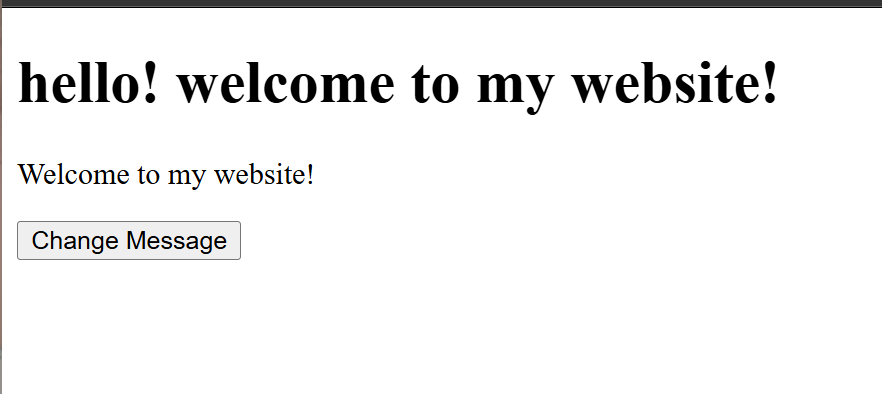
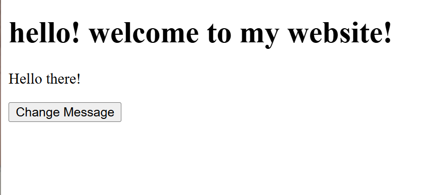
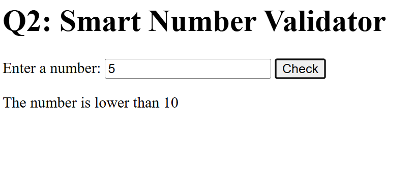
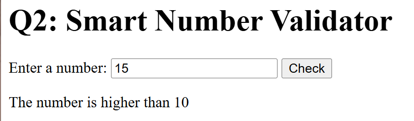
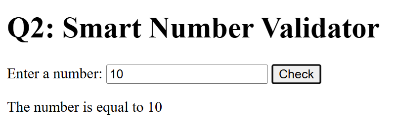
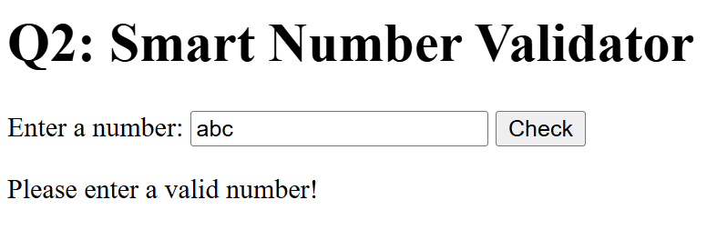
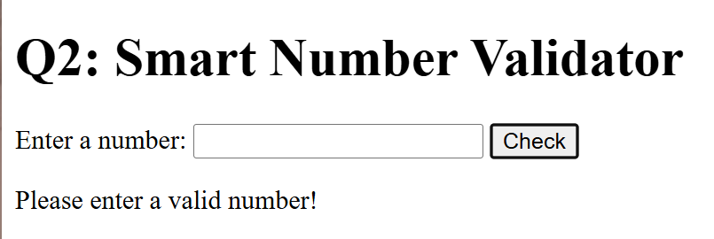
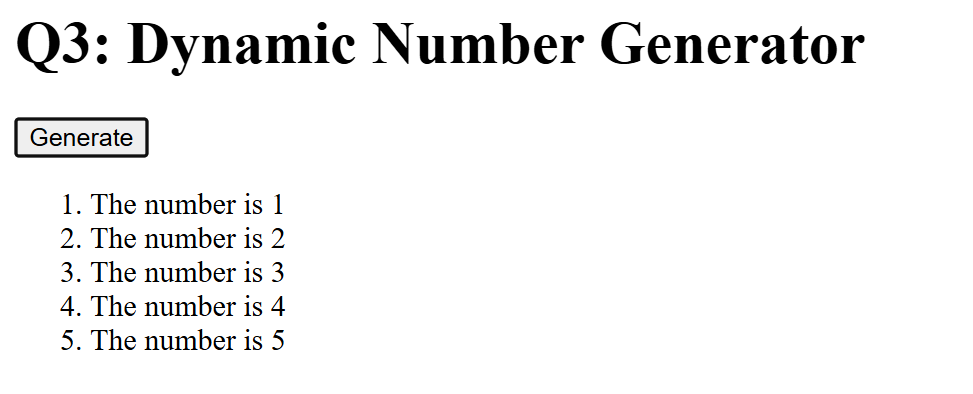
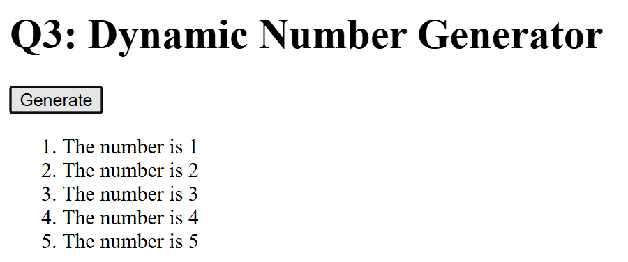

# BIC21203 Lab 4a - Client-Side Scripting (JavaScript)

**Name:** SEE RUI LONG
**No matric:** AI250206

## Overview
This lab uses HTML5 and JavaScript (no external libraries) to update page
content, validate user input and generate HTML elements dynamically.

## How to Run
Download or clone the repository, then open the `index.html` file of each
question in a desktop browser.

### Q1 - Interactive Text Changer
Open `Q1/index.html`. Click "Change Message" to change the paragraph to
"Hello there!". Uses `getElementById`, `changeMessage()` and `addEventListener`.

### Q2 - Smart Number Validator
Open `Q2/index.html`. Enter a value and click "Check". `checkInput()` trims the
input, rejects empty or non-numeric values, then uses `if...else if...else`
to compare the number with 10.

### Q3 - Dynamic Number Generator
Open `Q3/index.html`. Click "Generate" to create a list from 1 to 5 using a
`for` loop and `createElement`. The list is cleared first so repeated clicks
do not create duplicates.

